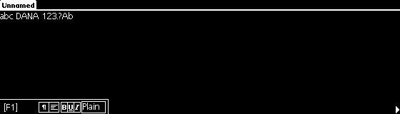
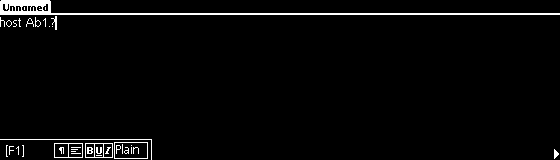

# DANA UK1.5 physical keyboard — CLOSED / NATIVE PASS (2026-10-30)

The sole installed `runtime/diag/bin/dana-diag` writes and edits text in AlphaWord under original Palm OS UK1.5. Complete candidate and installed campaigns passed: **81/81 physical inputs consumed by the original 68000**, complete releases and five simultaneous-key combinations. A separate physical-host campaign exercised XTest → SDL → MAME input → ST → IRQ1/SPI2 → original Palm code → AlphaWord.

Baseline: `66e9e7973c7b50ea6cc3766ffedcf07e2fc8cb38`, branch `main`, canonical T repository `/home/spc/Projects/alphasmart/DANA-emu`. The delivery commit is the commit introducing this report, obtainable with `git log -1 --format=%H -- docs/DANA_UK15_KEYBOARD_NATIVE_PASS_20261030.md`. No agents, clones, worktrees, development branches or second build trees were used.

## Original failure and implementation

The A input reached MAME and the existing ST queue, but ST data-ready was not connected to IRQ1. The guest remained waiting without further SPI2 reads. Ghidra and original-ROM execution established that UK1.5 requires this interrupt.

The existing inventory, SPI2 transport and queued key-state protocol remain in use. Driver changes:

- Active-low ST data-ready on PD4/IRQ1, IPR/ISR bit 16 and CPU interrupt level 1. PDDIR, PDSEL, ICR.POL1 polarity, ICR.ET1 edge/level selection, IMR and edge acknowledgement are respected. Pending ST state drives the signal; no interrupt is generated per frame.
- PDDATA input reports the external voltage; GPIO output configuration retains its latch.
- Existing ST reset/readiness/`0xAA` handshake is retained. Reset resamples physically held keys.
- Full `Get Ver!` request and four-byte `30 36 2E 38` response (`06.8`), confirmed by UK1.5 reads. This is the **reference ST model revision**, not a measurement from a physical chip.
- IRQ1 and version-exchange state participate in save-states.
- Postload compares actual host switches against saved held state and queues their current state through the normal ST protocol when different. An initial native robustness test exposed phantom Shift after restoring a snapshot while the host had already released it. The final screenshot shows `Aab`, with the two subsequent letters lowercase. No guest memory, PC or Palm events are written.

The existing queue capacity and overflow policy are preserved. The 200-stroke campaign showed no persistent communication loss or stuck modifier; this qualifies the tested load, not an unlimited queue.

ROM, character tables, Palm routines and CPU implementation are unchanged. Original firmware generates characters and application actions.

## Ghidra 12.1.3 and native chain

The existing `local-evidence/runtime-compare/DanaPalmUK15Touch.gpr` project and original `UK15_private.raw` program were used with `-readOnly -noanalysis`. Reproduction script: [DanaUK15KeyboardAudit.java](../tests/ghidra/DanaUK15KeyboardAudit.java). Its volatile MMIO block is temporary and discarded. Full disassembly/decompilation remains private under `local-evidence/runtime-compare/keyboard-20261030/ghidra-keyboard-delivery.*`.

| Original address | Verified role |
| --- | --- |
| `1007EE72` | ST reset/readiness: PK2 pulse and PB6 recovery; SPI2 control `2307`; compares `AA` at `1007EF22`. |
| `1007D676` | Version query: request at `1007D724`, four receive bytes at `1007D6EC`. |
| `10092E62` | Native IRQ1 vector target; trampoline dispatches through the implementation table. |
| `1007CEAC` | HwrIRQ1Handler implementation (SDK trap `A251`); calls `1007DE64` at `1007CEB0`. |
| `1007DE64` | KeyHandleInterrupt: calls ST reader `1007E5F2` at `1007DFC6`, processes state/modifiers and delivers events. |
| `1007E5F2` | SPI2 packet reader: exchange at `1007E632`, actual header read at `1007E648`, codes at `1007E896`; PE3 delimits transactions. |
| `1007EC48` | Original polling path: samples PD4 at `1007EC74`, header at `1007ECAA`, codes at `1007ED40`. |
| `1007ED94`, `1007EE0E` | Original modifier and special-code handling. |
| `10080670` | Translation through original firmware tables. |
| `1008021E` | Event conversion; invokes EvtEnqueueKey (`A12D`) at `1008028A`. |

Native IRQ1 observation: IVR `18`, vector `19`, pending `00010000`, IMR `0062E0ED`. Test taps count the original instructions that actually read SPI2 results, excluding 68000 `CLR.W` read-before-write transactions.

The BSD implementation was independently written around the existing project driver. Behavior references, without importing GPL code:

- [Retro68/POSE STMicro](https://github.com/csnover/Retro68/blob/d917b67b16bef7bcf5c75a74f617710c32addcbc/PalmUtils/poser/SrcShared/Hardware/EmSPISlaveSTMicro.cpp) and [VZ Dana](https://github.com/csnover/Retro68/blob/d917b67b16bef7bcf5c75a74f617710c32addcbc/PalmUtils/poser/SrcShared/Hardware/EmRegsVZAlphaSmart.cpp).
- [EmuTOS-Dana bios/dana.c](https://github.com/davidgiven/emutos/blob/9c42ef0f2c2fa9d1e217fced9da68901b2326e8b/bios/dana.c).
- Motorola MC68VZ328 User's Manual: PD4 GPIO, IRQ1/ICR/IMR and SPI2.

## Host keyboard and MAME conflicts

Use the official `tools/run-palm-uk15.sh` launcher. It copies standard MAME profiles into its temporary configuration and enables UI shortcuts so F12 works. Letters, numbers, punctuation, arrows and F1–F8 preserve their physical bindings. Character layout follows original UK1.5 firmware.

The [81-key CSV inventory](evidence/keyboard-20261030/inventory.csv) records each Dana label, ST scan, MAME port/mask, effective host sequence, native consumption/release and per-key screenshot. The [JSON result](evidence/keyboard-20261030/result.json) includes the same inventory and hashes.

| Function | Host key |
| --- | --- |
| Left/right Shift; Control; Dana Alt | Left/right Shift; Left Ctrl; Left Alt |
| Command | **Right Ctrl** or Left Super/Windows; Right Ctrl avoids desktop Super reservations |
| Caps Lock | Caps Lock |
| Calendar / Address Book / To-do | F9 / F10 / Insert |
| Memo/App4 | **Right Alt**; F12 remains screenshot |
| Search / Beam (Help) | F11 / Page Down |
| Menu (Undo) | **Page Up** or Menu key |
| Physical Dana `#` key | **End** or ISO BACKSLASH2 |
| Dana Home / Escape / power | Home / Escape / Pause |
| MAME screenshot | **F12** |
| MAME menu / MAME cancel | **Left Ctrl + Left Alt + Tab / Esc** |
| Existing sound controls | MAME menu → Sound Options; existing Volume 0–100 and Mute |

Unmodified Tab and Escape reach Dana. SDL testing confirmed F3/F5/F7/F8 reach the guest without MAME reset, pause or state loading. [default.cfg](../config/palm-uk15/default.cfg) moves reserved functions to the **Left Ctrl + Left Alt** prefix: F2 debugger, F3 reset, F4 graphics, F5 pause, F6 save state, F7 load state, F8/F9 frameskip, F10 throttle, F11 FPS, Insert fast-forward and tilde on-screen controls. Left Shift variants are explicit in the XML. Scroll Lock retains MAME's normal UI-mode toggle.

Application keys follow **original Palm button preferences**. The input labelled Memo/App4 opened or retained AlphaWord with this ROM's default assignment; the emulator does not force Memo Pad. Home opens the Palm launcher rather than moving to the start of a text line. Beam/Help reached original key handling; from the empty document it produced no new dialog. Its effect remains governed by original context rather than a fabricated emulator action.

## Visible AlphaWord behavior

The application session starts at original reset and traverses Setup 1, three calibration points, automatic host date in Setup 3, Setup 4, Enter Data, the desktop and AlphaWord.



Actual phrase: `abc DANA 123.?Ab`, using both Shift keys and Caps Lock on/off. [Original header/code trace](evidence/keyboard-20261030/alphaword-spi2.txt).

| Original application action | Installed evidence |
| --- | --- |
| Enter creates a new line | [Screenshot](evidence/keyboard-20261030/alphaword-enter.png) |
| Backspace removes X; subsequent typing adds ab | [Screenshot](evidence/keyboard-20261030/alphaword-backspace.png) |
| Left arrow + Delete leaves a on line two | [Screenshot](evidence/keyboard-20261030/alphaword-delete.png) |
| Shift + Left selects a | [Selection](evidence/keyboard-20261030/alphaword-selection.png) |
| Backspace deletes the selection | [Empty second line](evidence/keyboard-20261030/alphaword-selection-deleted.png) |
| Home opens original Palm launcher | [Desktop](evidence/keyboard-20261030/palm-home.png) |
| F2/F8 select original AlphaWord [F2]/[F8] slots | [F2](evidence/keyboard-20261030/key-52-4d.png), [F8](evidence/keyboard-20261030/key-46-45.png) |
| Dedicated application keys | Independent screenshots in the inventory: Calendar opens Date Book, Address Book opens Addressbook, To-do opens To Do List, Search opens AlphaWord search, Menu opens File/Edit. |
| Restore with a previously held Shift | [Aab without phantom Shift](evidence/keyboard-20261030/robust-restore.png) |
| Original repeat and prolonged typing | [Repeat](evidence/keyboard-20261030/robust-repeat.png), [200 strokes](evidence/keyboard-20261030/robust-prolonged.png) |

The physical-host test sends actual XTest keyboard events to the same emulator's SDL window. Its Lua observer is passive: it does not set MAME inputs, guest characters, RAM or CPU registers. AlphaWord displayed **`host Ab1.?`**. The test exercised both Shifts, Right Ctrl/Command, Tab, Escape, F3/F5/F7/F8, Right Alt/Memo, Page Up/Menu and End/#. F12 produced a **new native MAME screenshot**, checked against the prior file list.



- [Native F12 screenshot](evidence/keyboard-20261030/sdl-f12.png).
- MAME menu via the configured chord: 23 active-menu frames in the [native host result](evidence/keyboard-20261030/sdl-host-native.txt). The [guest framebuffer captured during that menu](evidence/keyboard-20261030/sdl-menu.png) contains only the underlying guest screen, since MAME UI overlays are outside guest LCD memory.
- [Guest menu via Page Up](evidence/keyboard-20261030/sdl-guest-menu.png).
- [Return to AlphaWord and # via End](evidence/keyboard-20261030/sdl-after-menu.png).

## Complete campaign and directed regressions

| Check | Native result |
| --- | --- |
| Physical inventory | **81/81**, no missing codes, host samples or releases |
| Original SPI2 reads | **184 headers**, **87 release packets**, original read PCs verified |
| Simultaneous combinations | **5/5**: Shift+A, Ctrl+C, Alt+Tab, Command+A, Right Shift+Up |
| Robustness | Released-modifier restoration, held-key repeat, 200 strokes, reset and subsequent communication; **208 codes**, `stale_modifier=false` |
| Power/suspend/wake | Scan `0F` pressed twice; original polling/IRQ path and releases observed |
| SDL/MAME | Visible text, 23 MAME-menu frames, no unintended pause frames; fresh F12 capture; Command/Menu/# aliases verified; final host wrapper return **0** |
| RTC/host calendar | Directed tests PASS; cold boot automatically shows **30/10/26** |
| Touch/calibration/SPI2 ADC | Three points and full Setup→desktop→AlphaWord flow PASS |
| PWM1/audio | Original 48 kHz mono WAV, peak 5976, **6833 nonzero samples**; PWM1 implementation preserved |
| Volume/mute | Existing Sound Options sources unchanged; native `ui_mute` readback/restore PASS |
| SD | Protection, CRC, writes to both disposable test cards and reopen/persistence: **4/4 PASS**, CPU marker `A55A` |
| EmuTOS-Dana | Unmodified canonical archived guest: 609 SPI2 reads, three codes/releases, continuing CPU; GPIO-selected PDSEL correctly gates IRQ1 off |
| Local tests | ST/IRQ1 protocol, SDL geometry, UK1.5 RTC and host calendar: **4/4 PASS** |

The EmuTOS regression qualifies boot and native keyboard consumption, not a new EmuDesk editing acceptance. No manual speaker-listening acceptance is claimed. Save-state compatibility across executables with different state layouts is not claimed; restoration within the new executable is tested.

## Demonstrated SDL dependency

T's existing desktop Xwayland reports a **0×0** monitor. With UI active, `pixel_aspect()` produced NaN and MAME aborted drawing menu/F12 at `render.cpp:784`. SDL/X11 geometry and a bounded native backtrace confirmed the cause. The small BSD [monitor_module.h](../src/osd/modules/monitor/monitor_module.h) overlay returns square pixel aspect only for non-positive dimensions. The existing formula for valid monitors is unchanged and covered by a directed test.

Physical SDL testing used a temporary rootful Xwayland session of the existing desktop, without TCP or elevated privileges, with ephemeral authentication and standard `-displayfd`. This allows XTest delivery to the same MAME without changing desktop settings. It is not another emulator or build environment. The owned server and authentication are cleaned up on exit.

## Incremental build, installation and identities

Clang **21.1.8**, existing build cache:

```sh
cd runtime/diag/source
make -j2 TARGET=mame SUBTARGET=danadiag SOURCES=src/mame/skeleton/alphasdana.cpp \
  BUILDDIR=build/dana-diag DEBUG=1 PRECOMPILE=0 TOOLS=0 USE_QTDEBUG=0 \
  OVERRIDE_CC=clang OVERRIDE_CXX=clang++ OVERRIDE_LD=clang++
```

Canonical driver and monitor overlay must match their copies under `runtime/diag/source/src/` before building. No second tree or full MAME rebuild was needed.

The previously qualified installed executable was preserved until the complete candidate PASS. The sole `runtime/diag/bin/dana-diag` was then replaced and the full installed campaign repeated. The technical build artifact `runtime/diag/source/danadiagd` no longer exists. The previous executable remains only as a private compressed rollback archive, not a second installed executable.

| Artifact | SHA-256 |
| --- | --- |
| Sole installed/tested executable | `db7404acb1b0ea44431d05e442dac231c1add2508bd1bcd217c35c2d628f5f3e` |
| Canonical/build driver, byte-identical | `003d31ac41845cea553dc138084785a1a319b7caa7d86ebe79e97b2b4e61ec08` |
| Archived previous executable | `1d2478b107c150321e5aca2051c09c80dad061e32079e1cb066c684d89b26d6e` |
| Original UK1.5 ROM, 6,094,848 bytes, unchanged | `2f607705738e470d892bfefb9a5dcae1fb3c4195d070c358224e20c93bf365e3` |

## Reproduction and evidence

On T with the existing private ROM at its canonical path:

```sh
python3 tests/run_keyboard_campaign.py --prefix keyboard-recheck-UNIQUE
```

The runner defaults to the sole installed executable, starts its own fresh original-ROM session and keeps private evidence under `local-evidence/runtime-compare/`. `--candidate` selects an already-built artifact in the same existing tree before installation; it does not build another emulator. Historical ST81 entry points now delegate to this full campaign and cannot install from packet-only results.

Private delivery records:

- `keyboard-20261030/keyboard-final-candidate-campaign/result.json`.
- `keyboard-20261030/keyboard-installed-campaign/result.json`.
- `calendar-host/keyboard-installed-{application,all81,robust}`.
- `keyboard-20261030/keyboard-installed-compatibility/result.json`.
- `keyboard-20261030/sdl-installed/` and `sdl-final-aliases-receipt.json`.
- `calendar-host/keyboard-sound-control-installed/calendar.txt`.

Public evidence: [result and inventory](evidence/keyboard-20261030/result.json), [SHA-256 manifest](evidence/keyboard-20261030/SHA256SUMS.json), [all-81 native SPI2 trace](evidence/keyboard-20261030/all81-spi2.txt), original framebuffers and host mappings. Published screenshots come from fresh test sessions containing test phrases/factory data only. No ROM, RAM dumps, save-states, private WAV, Ghidra project or personal Palm documents are published.

**Closure:** original keyboard and AlphaWord writing/editing are accredited; 81/81 inputs, modifiers, accessible special keys, directed regressions and the sole installed executable PASS. No keyboard blocker remains identified under the tested workload.
